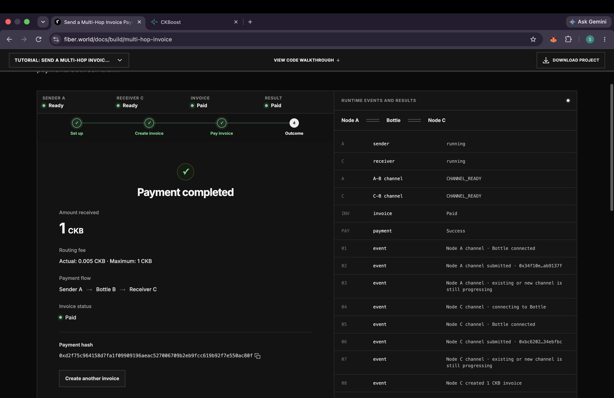
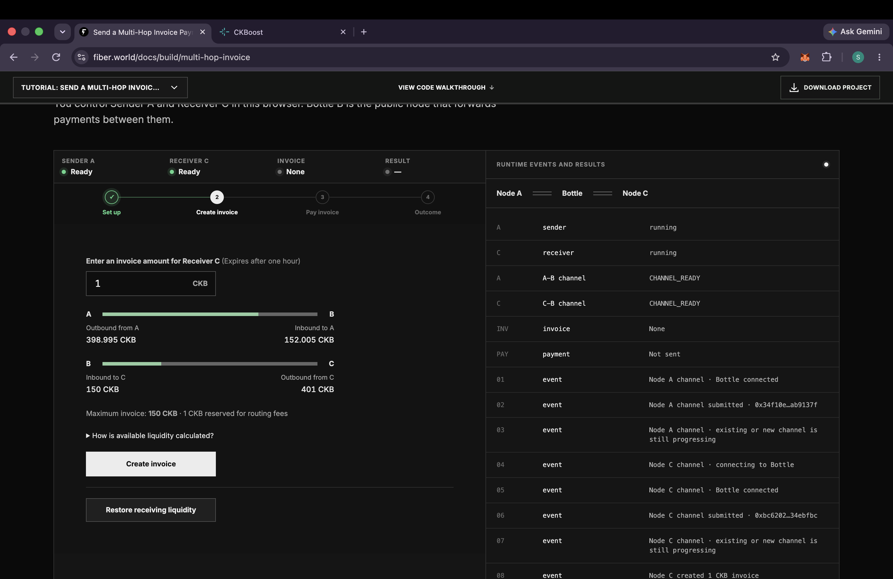
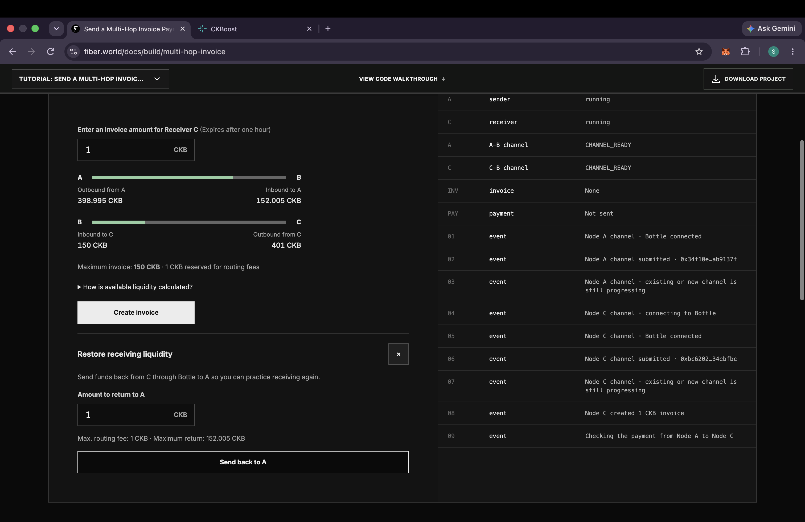
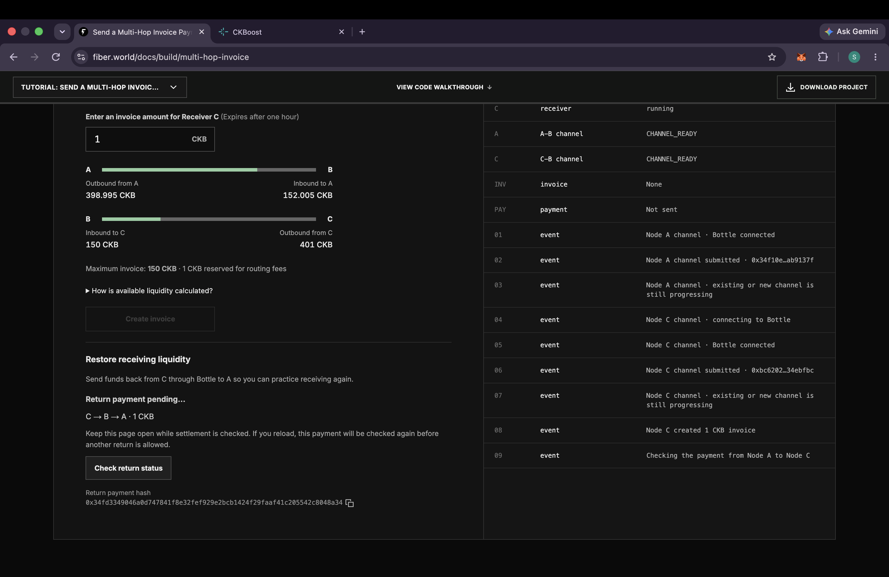
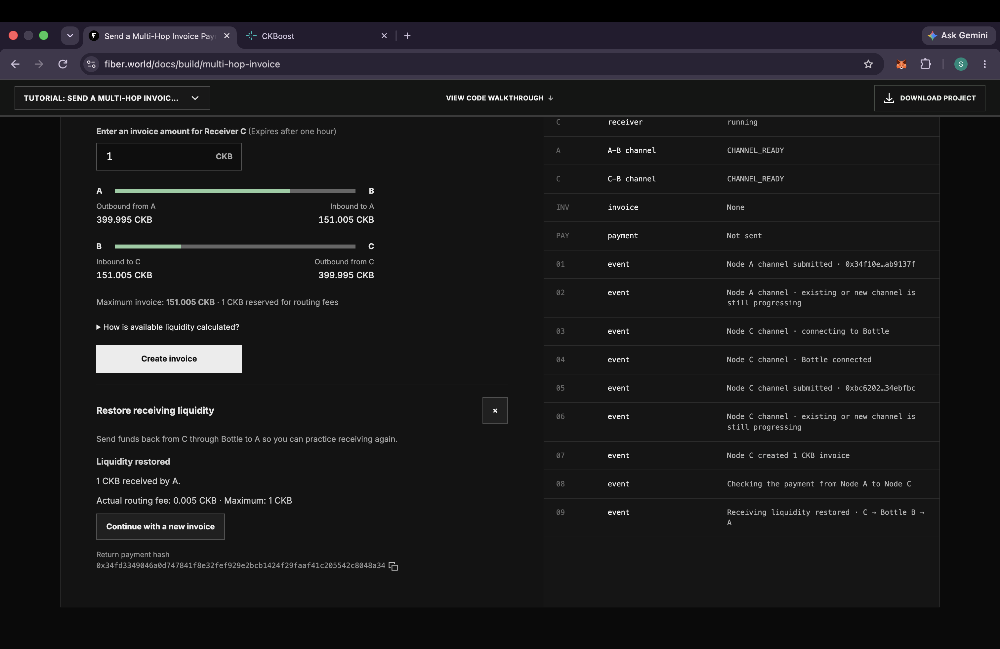
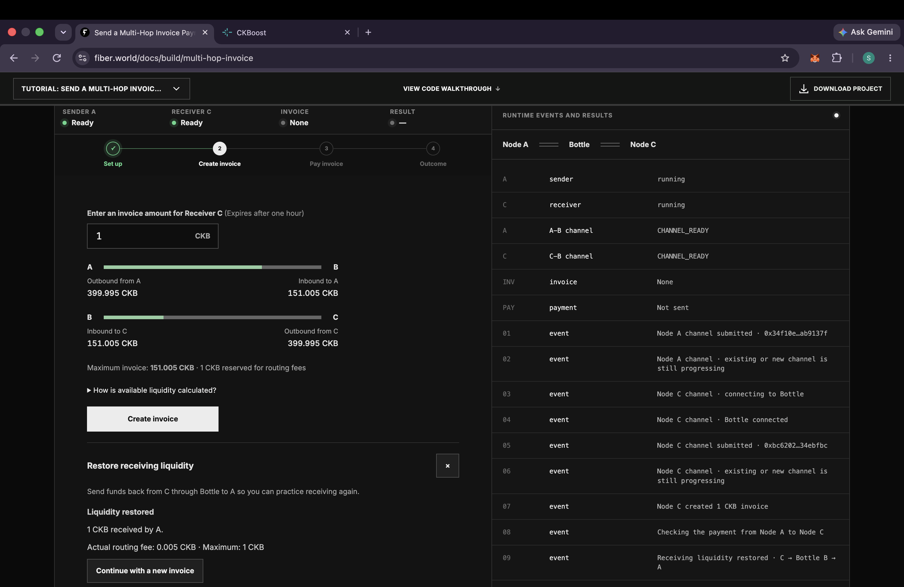

# Fiber Multi-Hop Invoice Payment: Campaign Submission

Hosted demo: https://fiber.world/docs/build/multi-hop-invoice
Route: Sender A → Bottle B → Receiver C (Fiber Testnet)

## Quest 1: Multi-hop invoice payment (1 CKB, A → B → C)

- Payment completed, amount received: 1 CKB
- Routing fee: 0.005 CKB (maximum allowed: 1 CKB)
- Invoice status: Paid
- Payment hash: `0xd2f75c964158d7fa1f09909196aeac527006709b2eb9fcc619b92f7e550ac80f`

## Quest 2: Restore receiving liquidity (1 CKB, C → B → A)

### Liquidity before the return payment

| Channel | Our node's side | Bottle's side |
|---|---|---|
| A–B | A: 398.995 CKB | 152.005 CKB |
| B–C | C: 401 CKB | 150 CKB |

### Return payment

- Liquidity restored: 1 CKB received by A
- Routing fee: 0.005 CKB (maximum allowed: 1 CKB)
- Return payment hash: `0x34fd3349046a0d747841f8e32fef929e2bcb1424f29faaf41c205542c8048a34`

### Liquidity after the return payment

| Channel | Our node's side | Bottle's side |
|---|---|---|
| A–B | A: 399.995 CKB | 151.005 CKB |
| B–C | C: 399.995 CKB | 151.005 CKB |

## Setup process (supporting screenshots)
See the `process/` folder: node startup, faucet funding for A and C,
and each channel moving through the opening states to CHANNEL_READY.
Attempt 1's channel for C stalled, so I restarted with fresh nodes (attempt 2).
